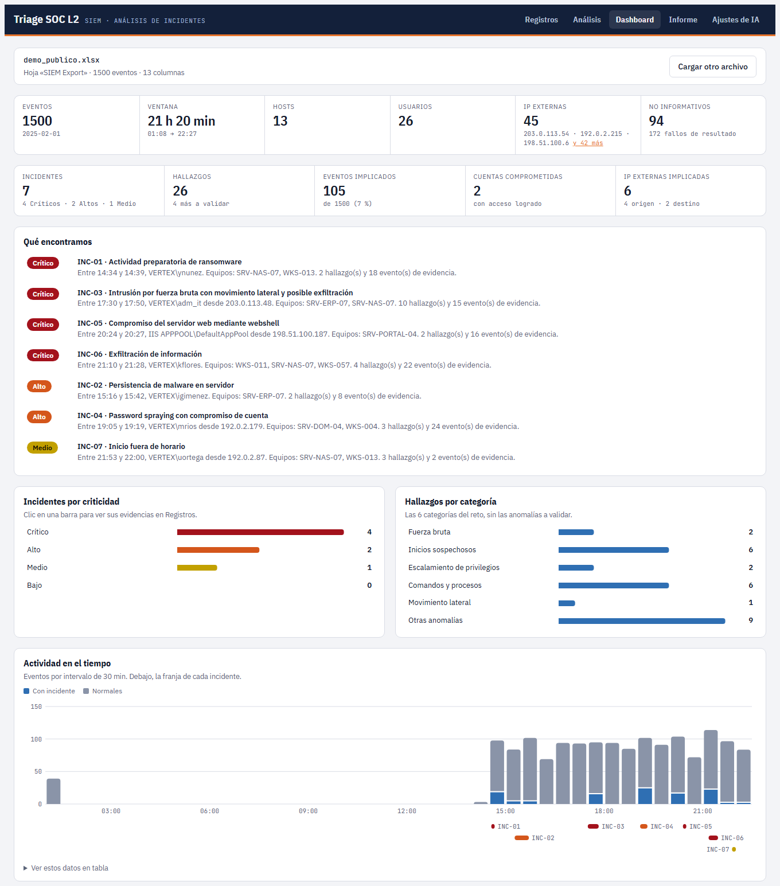

# Triage SOC L2 v1.0

Primera versión. Descarga triage-soc-l2-v1.0.zip, descomprímelo y abre ABRIR_AQUI.html en el navegador. No hace falta instalar nada; sin clave de API, todo funciona con plantillas.

SHA-256 de triage-soc-l2-v1.0.zip:
d9dcbe117bae617b39f7a76c40df8617f6cdbb6eabc5f77dfa9d477fdb0331e2

Comprobar: sha256sum triage-soc-l2-v1.0.zip (Linux) o Get-FileHash triage-soc-l2-v1.0.zip (PowerShell).

App web para el triage de un analista SOC de nivel 2. Carga un Excel exportado de un SIEM, detecta y correlaciona incidentes con reglas, clasifica su riesgo (Crítico, Alto, Medio, Bajo) y genera un informe ejecutivo y otro técnico en PDF. Una IA opcional explica y redacta, y cada cita que hace se comprueba contra el archivo. Todo se procesa en el navegador.

Proyecto final del bootcamp de Analista SOC L2 (noviembre de 2026).

- **Video de la demo:** [RELLENAR: enlace al video](RELLENAR_ENLACE_VIDEO)
- **Informe en PDF generado con la app:** [RELLENAR: enlace al PDF](RELLENAR_ENLACE_PDF)



*Dashboard con el dataset sintético `datasets/demo_publico.xlsx`.*

## Qué hace

- **Detecta** fuerza bruta y password spraying, inicios sospechosos (por origen, horario o patrón), escalamiento de privilegios, comandos y procesos sospechosos, movimiento lateral y otras anomalías (webshell, persistencia, ejecución periódica, exfiltración).
- **Correlaciona** los hallazgos en incidentes por actor y ventana de tiempo, con su técnica MITRE ATT&CK y sus evidencias (Log_ID).
- **Clasifica** cada incidente con una tabla de criterios explícita y separa las anomalías que conviene validar con el cliente.
- **Muestra** un dashboard con cifras, gráficos por criticidad y categoría, cronología y tops de equipos, cuentas e IP.
- **Genera** los dos informes en PDF: ejecutivo, para directivos, y técnico, con hallazgos, evidencias, criticidad, impacto, plan de acción por incidente y recomendaciones.

## Cómo abrirla (sin instalar ni ejecutar nada)

1. Descarga `triage-soc-l2-v<versión>.zip` de la página de Releases y descomprímelo en cualquier carpeta.
2. Abre `ABRIR_AQUI.html` con el navegador: doble clic en Windows; en Linux, si se abre en un editor de texto, usa clic derecho → *Abrir con* → Firefox o Chromium.
3. Arrastra tu Excel a la página, o prueba con `datasets/demo_publico.xlsx`.

Probada en Windows con Edge y Chrome. Los registros se procesan en tu navegador; solo salen del equipo si usas una IA por API.

**Sin clave de API, todo funciona con plantillas**: detección, criticidad, explicaciones, dashboard y los dos PDF salen de las reglas. La IA es opcional y solo añade redacción.

### `iniciar` y Node.js: solo para Ollama

`iniciar.bat` (Windows) y `./iniciar.sh` (Linux y macOS) solo hacen falta para usar **Ollama** (IA local). Con [Node.js](https://nodejs.org) instalado sirven `app/` en `http://127.0.0.1:8765` y abren el navegador; sin Node, abren la app directamente y avisan de que Node solo es para Ollama.

Una página abierta con doble clic (`file://`) envía `Origin: null`, y Ollama la rechaza con un error 403. La única forma de admitirla sería `OLLAMA_ORIGINS=*`, que **deja que cualquier web que visites use tu Ollama**, así que no se recomienda. En cambio, Ollama acepta por defecto `http://127.0.0.1`. El servidor de `iniciar` escucha solo en `127.0.0.1`, sirve únicamente lo que hay en `app/` y comprueba la cabecera `Host` para evitar ataques de DNS rebinding.

## Conectar una IA

Abre **Ajustes de IA**, elige el proveedor y pulsa **Probar conexión**. La configuración se guarda en este navegador.

| Proveedor | Datos necesarios | ¿Salen datos del equipo? |
|---|---|---|
| Sin IA | Ninguno; usa plantillas | No |
| Anthropic | Clave de API y modelo | Sí |
| Compatible con OpenAI | URL base, modelo y clave opcional | Sí, salvo que el servidor sea local |
| Ollama (opcional) | Modelo; URL por defecto `http://localhost:11434`; abrir con `iniciar` | No |

También puedes dejarla en `app/ai.config.local.js` (copia de `app/ai.config.example.js`, no va a git). Ajustes indica si la configuración activa sale de ese archivo o del navegador, y **Restablecer** vuelve a la del archivo. La IA atiende una petición cada vez y el texto aparece mientras se genera.

Si el proveedor no es local, la app avisa de que las filas de evidencia salen del equipo. Una clave escrita en Ajustes se guarda sin cifrar en el navegador; la del archivo no se copia.

En el entorno del autor se usa Anthropic con `claude-haiku-5-5`: explicar los 6 incidentes de un export de 715 eventos y redactar el resumen ejecutivo cuesta alrededor de 0,01 $. Ollama se probó en una GTX 1660 Super de 6 GB y no fue viable con la GPU ocupada.

## Informes en PDF

En la pestaña **Informe**, escribe analista y cliente, revisa el texto (las frases se pueden editar; las tablas salen del motor) y marca **Revisado por el analista**. Después descarga `Informe_Ejecutivo_<fecha>.pdf` e `Informe_Tecnico_<fecha>.pdf`. Los PDF se generan en el navegador con [pdfmake](https://pdfmake.org), sin diálogo de impresión.

Las cifras, tablas, evidencias, técnicas MITRE y criticidades salen siempre del motor. Los textos de IA van marcados en el PDF con el modelo, el número de citas verificadas y quién los revisó.

## Reglas e IA

Las reglas deciden qué es un incidente y su criticidad; la IA solo explica y sugiere. Cada respuesta pasa por un validador que comprueba que:

- el Log_ID citado exista en el archivo y sea evidencia de ese incidente;
- la cuenta, el equipo o la IP de la frase coincidan con la fila citada.

En el resumen ejecutivo, además, se comprueba que cada cifra y cada INC-xx estén en los datos del motor.

**El validador no comprueba todo.** No detecta cantidades o interpretaciones falsas apoyadas en citas válidas, como decir que todas las peticiones llevaban un parámetro cuando solo lo llevaban algunas. Las explicaciones de la IA deben revisarse antes de usarlas en un informe.

## Cómo se construyó

### Principios

1. **Nada fijo del dataset en el código**: ni IP, ni cuentas, ni equipos, ni Log_ID. Solo reglas genéricas con umbrales configurables.
2. **La IA no decide qué es un incidente**: explica, redacta y sugiere, y sus citas se validan.
3. **Funciona entera sin IA y sin instalar nada**: HTML y JavaScript sin paso de build, con las librerías incluidas.
4. **Nada sensible en git**: ni el Excel del cliente, ni datos derivados, ni claves. La demo pública es sintética.

### Fases

| Fase | Resultado |
|---|---|
| 1–2 | Prototipo: lectura del Excel y primeras reglas |
| 2.5 | Reestructuración en módulos que funcionan en el navegador y en Node, sin paso de build |
| 2.6 | Generador de datasets sintéticos con verdad de referencia y prueba de generalización |
| 3 | Dashboard con colores de criticidad distinguibles con daltonismo |
| 4 | IA independiente del proveedor, con streaming y validador de citas |
| 5 | Informes ejecutivo y técnico en PDF |
| 6 | Empaquetado: abrir sin ejecutar nada, zip de entrega con SHA-256 |
| 7 | Repositorio y README |

Cada fase terminó igual: pruebas en verde, demostración en el navegador, revisión del autor y commit. Las decisiones y sus motivos están en [`docs/PROGRESO.md`](docs/PROGRESO.md) y el plan en [`docs/PLAN.md`](docs/PLAN.md).

### Pruebas

```
node tests/test_generalizacion.js   # datasets sintéticos: cobertura y falsos positivos
node tests/test_dashboard.js        # cifras del dashboard frente al motor
node tests/test_ia.js               # adaptadores, errores, validador y prompts, sin proveedor real
node tests/test_informe.js          # informes completos y sin Log_ID inexistentes
node tests/test_pdf.js              # PDF completos y con todos sus caracteres en la fuente
node tests/test_servir.js           # servidor local
node tests/test_cliente.js          # Excel real; sin él, sale con un aviso
```

La prueba de generalización usa 30 semillas sintéticas: 100 % de cobertura y 0 incidentes falsos. Demuestra que el motor no depende de los valores de un cliente concreto. No demuestra que detecte ataques nuevos, porque el generador se escribió conociendo las reglas.

Para crear un dataset sintético: `node tools/generar_dataset.js --seed 42 --eventos 1500 --out datasets/sint_42.xlsx`. `datasets/demo_publico.xlsx` se generó así.

Para crear el zip de entrega: `node tools/empaquetar.js --version 1.0` (requiere git). Deja `entrega/triage-soc-l2-v1.0.zip` y su `.sha256`, con la app, este README, la licencia, `iniciar`, `tools/servir.js`, `datasets/demo_publico.xlsx` y la captura del dashboard.

### Uso de IA

- **En la app**: la IA explica cada incidente citando sus Log_ID, sugiere eventos que las reglas no marcaron y redacta el resumen ejecutivo. En una de esas sugerencias señaló un acceso a un fichero sensible que la regla no reconocía; se corrigió la regla de forma genérica y se añadió el caso al generador.
- **En el desarrollo**: la app se programó con ayuda de Claude Code (Anthropic) como asistente. El autor definió los requisitos y las decisiones, revisó cada fase en el navegador y la aprobó antes de seguir; cada afirmación sobre los datos se comprobó contra el Excel.

## Librerías incluidas

Están en `app/vendor/` para que la app funcione sin instalar nada ni descargar código. Ninguna se ejecuta fuera del navegador.

| Librería | Versión | Licencia | Archivo | SHA-256 |
|---|---|---|---|---|
| [SheetJS CE](https://sheetjs.com) (lee el Excel) | 0.20.3 | Apache-2.0 (`xlsx.LICENSE.txt`) | `xlsx.full.min.js` | `cc015130aa8521e7f088f88898eba949ccdcbfb38df0bd129b44b7273c3a6f41` |
| [pdfmake](https://pdfmake.org) (genera los PDF) | 0.3.12 | MIT (`pdfmake.LICENSE.txt`) | `pdfmake.min.js` | `d69c826c67a1d943a8ef602abdfbe5f15d680f3533aa345b19549fae69828f10` |
| Fuente Roboto, incluida con pdfmake | 3.014 | SIL OFL 1.1 (`Roboto.OFL.txt`) | `vfs_fonts.js` | `1483ed267fe00ad90a3834441b019d856dd41ed079b2614404b2fcef425db6fc` |

SheetJS se descargó de `cdn.sheetjs.com` (la 0.18.5 de npm tiene vulnerabilidades conocidas) y pdfmake de npm, con su integridad verificada. Para comprobarlas: `sha256sum app/vendor/*.js` en Linux o `Get-FileHash app\vendor\*.js` en PowerShell.

**Ningún script es necesario para usar la app.** `iniciar` es solo para Ollama, y `tests/` y `tools/` son para desarrollo.

## Licencia

[MIT](LICENSE). Las librerías de `app/vendor/` conservan sus licencias.
